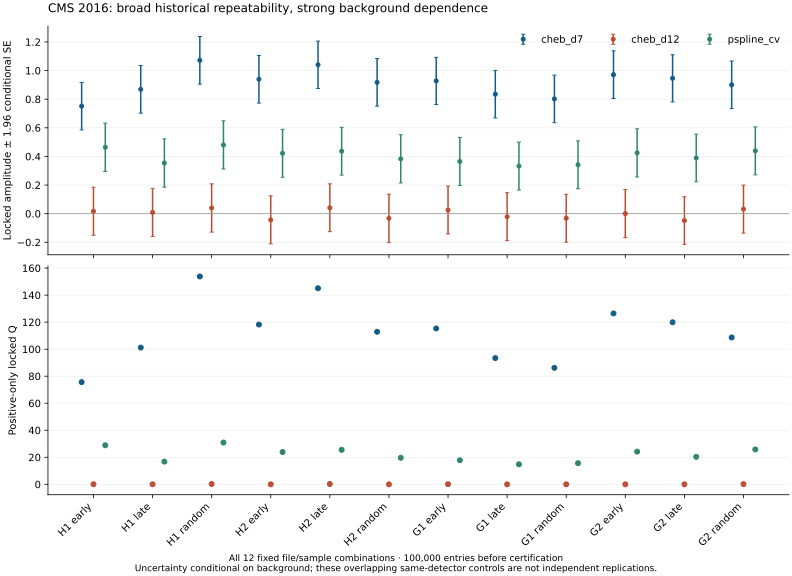

# Raw event recovery and frozen condition sweep

Execution dates: 2026-10-15/16. Baseline: main `c1e24d13a34e5b68ebf8615444168ce04cfcac69` (PR #16 merged). Historical outputs under `audit/2026-09-06` are unchanged. New evidence is under `audit/2026-10-15`.

## Issue #3: freshly reproduced event controls

All four complete original ROOT files passed their published byte-size and Adler-32 checks; independently computed SHA-256 values are in `event_input_receipts.json`, `event_input_receipts_session2.json`, and `events/summary.json`. Raw files are reproducible downloads, not Git artifacts. The existing event-control implementation was reused with explicit input/output paths and a refusal to overwrite an existing output directory.

The historical cap is the first 100,000 entries **before** luminosity certification. Entry parity is applied after certification, preserving the original implementation. The event key is `(run, luminosityBlock, event)`; all six between-file overlaps and every within-file duplicate count are zero. All four float32 mass histograms match the archived histograms exactly.

| File | Certified events | All qualifying pairs | Events with pairs | Float64 histogram L1 difference |
|---|---:|---:|---:|---:|
| H1 | 50,951 | 25,275 | 22,591 | 12 |
| H2 | 90,868 | 45,188 | 40,184 | 18 |
| G1 | 100,000 | 46,816 | 42,940 | 21 |
| G2 | 100,000 | 45,803 | 42,267 | 33 |

`events/selections.csv` archives baseline precision, same-sign, one-pair-event, pT, eta, medium-ID, isolation, dxy, historical HLT-bit, and parity controls for degrees 7 and 12. `events/bootstrap.csv` contains the declared 300 event-cluster bootstrap trials per H2/G1/G2 and background, seed 20260911. The degree-7 95% amplitude intervals are H2 [0.81290451, 1.09443941], G1 [0.77608288, 1.10400295], and G2 [0.82730268, 1.12141846].

`event_comparison_complete.json` pairs the regenerated quantities with the unchanged `prior_pass_event_observations.json`. Counts and run compositions match exactly; same-sign scores differ by at most 3.6e-15, and bootstrap intervals agree to floating-point precision. The regenerated G2 float64 locked score is 126.4411516403917. Thus no event-control conclusion needs to rely only on the pre-rollback pass.

Trigger feasibility is explicitly limited: these executions read available HLT bits, but do not match reconstructed muons to trigger objects or measure/unfold trigger efficiency. Such matching requires a separately validated trigger-object/filter mapping and efficiency calibration. The preserved event receipts, source script hashes, cutflows, and exact selections permit #4/#5 to reproduce the present bit-based controls. Separate files from CMS 2016 share detector, trigger, and reconstruction; they are not independent-detector replication.

All original recovery criteria are satisfied: **PASS_CLOSED**, subject to review of this unmerged implementation PR. This closes the recovery obligation, not a physics-significance claim.

## Issue #7: executed 1,800-row condition matrix

The protocol was published in commit `c749ee00d7197bbf2261a98faca6aaa0a578427a` before the full score evaluation. `control_matrix.json` SHA-256 is `d8d1c078e8b29f990cd403511338a76a2414fd68a8aa3a2ee41a9922072513ea`. The locked frequency is 7.025825825825827 and phase is -0.2313916852932179; neither was refitted.

The 12 file/sample combinations cover H1/H2/G1/G2 and early/late/random 100,000-entry samples, capped before certification (random seed 20261015). Controls include every run, prespecified run/luminosity partitions, historical trigger paths, parity, same sign, one pair per event, pT/eta/ID/isolation/dxy cuts, barrel/forward and low-pT selections, a 20/10-GeV plateau **proxy**, and prespecified mass-range/mask perturbations. `conditions/execution.json` retains cutflows, sample overlaps, source hashes, environment, and limitations.

All 1,800 rows are archived losslessly in `conditions/results.csv.gz`: 1,068 evaluated, 657 low count, and 75 failed fits (all fewer than eight analysis bins). No unfavorable or low-power row was removed. Every usable control reports counts, signed locked amplitude, sign, Q, predictive deviance, event-cluster conditional standard error, and injected-amplitude retention. The uncertainty holds the fitted background fixed; deterministic injection retention is not a detection-power calculation.

| Model | Nominal positive amplitudes / 12 | Nominal amplitude range | Nominal Q range | Unit-injection retention |
|---|---:|---:|---:|---:|
| Historical degree 7 | 12 | 0.7513–1.0715 | 75.628–153.808 | 0.8587–0.8697 |
| Degree 12 | 7 | -0.0481–0.0414 | 0–0.2299 | 0.2467–0.2908 |
| Predictive-CV penalized spline | 12 | 0.3326–0.4804 | 14.824–30.920 | 0.4214–0.5472 |

The spline uses 16 basis functions and score-independent five-fold blocked predictive selection over penalties 0.1, 1, 10, 100. It is the competitive flexible alternative. Degree 12 has extremely poor blocked predictive extrapolation here and cannot be called competitive merely because it reduces the candidate score. Flexible fits also absorb injected signal; attenuation alone does not prove absence of a physical modulation.



The four nonpositive degree-7 controls are low-power partitions: H1/random/run283270 (1,273 pairs, amplitude -0.0835, SE 0.2413); G1/random/run279588/lumi0 (1,166, -0.3013, 0.5198); G2/early/min-pT4–6 (3,640, -0.00139, 0.09466); G2/random/run278975/lumi1 (1,532, -0.0454, 0.1492). They do not establish a localized detector cause.

The prespecified common-smooth-shape experiment uses the pooled early H2/G1/G2 penalized-spline shape and 200 Poisson trials (seed 20261016), refitting each historical background. All 200 degree-7 trials have positive amplitudes in all three files, so a shared smooth shape can generate repeated signs. However, **zero of 200** reproduce the observed minimum Q=115.32114; simulated 5/50/95% quantiles are 53.286/76.767/96.601. For degree 12 the observed minimum is zero and all 200 trials exceed it. This is a limited common-shape experiment, not a validated detector-response model or full-sweep discovery calibration. All 400 model/trial results are retained.

Scientific classification: **BROAD_DEGREE7_REPEATABILITY_WITH_BACKGROUND_AND_SELECTION_DEPENDENCE**. No resolved run/trigger/kinematic concentration is established. Multiplicity across these dependent controls forbids promoting a favorable partition into a fresh discovery test. Determination C remains unchanged.

Closure: **PARTIAL_OPEN**. The full prescribed executable sweep is archived, but the 20/10-GeV proxy is not a measured trigger plateau, there is no validated response/efficiency model, conditional errors omit background refitting, and the common-shape experiment does not reproduce the observed joint degree-7 strength. These are explicit remaining limitations of the added acceptance-systematic discriminator.

## Reproduction and receipts

Install `experiments/cms_audit/requirements.txt` and the package's dev extras. Use new output paths:

```bash
python scripts/recover_cms_event_inputs.py --directory /tmp/cms-originals --download --output NEW/inputs.json
OPENBLAS_NUM_THREADS=1 OMP_NUM_THREADS=1 python experiments/cms_audit/run_event_controls.py --input-root /tmp/cms-originals --output NEW/events
python scripts/compare_event_recovery.py --directory NEW/events --output NEW/event_comparison.json
OPENBLAS_NUM_THREADS=1 OMP_NUM_THREADS=1 python experiments/cms_audit/run_condition_sweep.py --protocol audit/2026-10-15/control_matrix.json --input-root /tmp/cms-originals --output NEW/conditions
python experiments/cms_audit/summarize_condition_sweep.py --directory NEW/conditions
python -m pytest -q
```

The full suite passes: **60 tests**. New adversarial regressions check pre-certification sampling, shared-event covariance, preservation of low-count controls, and reproduction of the historical fit on a deterministic fixture. `receipt.json` hashes compact evidence and source files. Historical artifacts remain immutable. The event and condition execution records describe the actual environment; a future rerun may differ at floating-point roundoff.
